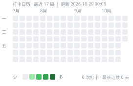

<div align="center">

# 网络对抗实验室 · Net Evasion Lab

**16 周，从「只会点软件」到「看得懂协议、搭得起隧道、说得清检测原理」**

零基础起点 · 实验驱动 · 弹性打卡 · 全平台（Windows / macOS / Android / iOS）

[](progress.json)
[](progress.json)
[](progress.json)

</div>

---

## 这是什么

一份把「翻墙 / 代理 / 抗检测」拆成可学习工程的路线图。它不教你复制粘贴一份配置文件，而是带你从**数据包怎么走**开始，一路做到**能自己设计一个混淆层并评估它**。

核心问题只有一个：

> 审查方（GFW、企业防火墙、CDN 风控、平台反爬）在**看什么**？我们能不能让它看到的东西是对的？

所有技术都是这个问题的不同答案。

## 这不是什么

- ❌ 不是「一键翻墙」教程合集
- ❌ 不包含任何真实服务器地址、UUID、订阅链接（公开仓库，自己保管）
- ❌ 不教批量注册 / 养号 / 绕封禁 / 规避雇主安全监控
- ❌ 不保证任何服务条款上的合规性——这块请自己读 [OpenAI](https://openai.com/policies/terms-of-use) / [Anthropic](https://www.anthropic.com/legal/consumer-terms) 的地区与使用条款

合法性与边界见 [`docs/03-compliance.md`](docs/03-compliance.md)。

---

## 进度



<!-- PROGRESS:START -->
> 🕒 更新于 2026-10-29 00:08 (+08:00) ｜ ✅ **0 / 112** 项 ｜ 🔥 连续 **0** 天 ｜ 活跃 0 天

| 阶段 | 进度 | 完成 |
|:--|:--|:--:|
| **基础层** W1–W4 | `▱▱▱▱▱▱▱▱▱▱` 0% | 0 / 25 |
| **协议层** W5–W8 | `▱▱▱▱▱▱▱▱▱▱` 0% | 0 / 27 |
| **工程层** W9–W11 | `▱▱▱▱▱▱▱▱▱▱` 0% | 0 / 22 |
| **风控层** W12–W13 | `▱▱▱▱▱▱▱▱▱▱` 0% | 0 / 15 |
| **研究层** W14–W16 | `▱▱▱▱▱▱▱▱▱▱` 0% | 0 / 23 |

**每周进度**

```
W01 ▱▱▱▱▱▱ 0/7    W02 ▱▱▱▱▱▱ 0/6    W03 ▱▱▱▱▱▱ 0/6    W04 ▱▱▱▱▱▱ 0/6
W05 ▱▱▱▱▱▱ 0/7    W06 ▱▱▱▱▱▱ 0/7    W07 ▱▱▱▱▱▱ 0/6    W08 ▱▱▱▱▱▱ 0/7
W09 ▱▱▱▱▱▱ 0/7    W10 ▱▱▱▱▱▱ 0/8    W11 ▱▱▱▱▱▱ 0/7    W12 ▱▱▱▱▱▱ 0/8
W13 ▱▱▱▱▱▱ 0/7    W14 ▱▱▱▱▱▱ 0/7    W15 ▱▱▱▱▱▱ 0/8    W16 ▱▱▱▱▱▱ 0/8
```
<!-- PROGRESS:END -->

---

## 16 周路线总览

| 周 | 主题 | 阶段 | 你会得到什么 |
|:--:|:--|:--|:--|
| [01](weeks/w01-packet-journey.md) | 数据包是怎么走的 | 基础层 | 能用 Wireshark 讲清一次访问的全过程 |
| [02](weeks/w02-tls-https.md) | TLS 与 HTTPS 握手 | 基础层 | 知道 SNI 为什么是审查抓手 |
| [03](weeks/w03-proxy-model.md) | 代理的模型 | 基础层 | 手搓 SOCKS5 隧道，理解 DNS 泄漏 |
| [04](weeks/w04-firewall-dpi.md) | 防火墙与 DPI | 基础层 | 列出「检测手法 → 反制手段」对照表 |
| [05](weeks/w05-shadowsocks.md) | Shadowsocks 与被识别的历史 | 协议层 | 理解「随机流」为什么会被熵检测抓 |
| [06](weeks/w06-vmess-vless.md) | VMess / VLESS / XTLS | 协议层 | 理解 TLS-in-TLS 检测与 splice 优化 |
| [07](weeks/w07-trojan.md) | Trojan 与「像 HTTPS」的极限 | 协议层 | 理解回落机制如何对抗探测 |
| [08](weeks/w08-reality-quic.md) | REALITY / uTLS / QUIC 系 | 协议层 | 配出第一个 REALITY 入站，查自己的 JA3 |
| [09](weeks/w09-vps.md) | VPS 选型与初始化 | 工程层 | 一台加固好的服务器 + 线路认知 |
| [10](weeks/w10-deploy-reality.md) | 部署 Xray + REALITY 全流程 | 工程层 | 5 台设备全部跑通 |
| [11](weeks/w11-routing-dns.md) | 分流、DNS、泄漏自测 | 工程层 | 一套可日常用的分流规则 |
| [12](weeks/w12-ip-reputation.md) | IP 信誉与平台风控 | 风控层 | 知道「通了」和「可用」差在哪 |
| [13](weeks/w13-quality-eval.md) | 出口质量评测方法论 | 风控层 | 一个能跑 7 天的评测脚本 + 数据 |
| [14](weeks/w14-active-probing.md) | 主动探测与探测抵抗 | 研究层 | 能解释 REALITY 的设计取舍 |
| [15](weeks/w15-papers-toy-protocol.md) | 读论文 + 写最小混淆层 | 研究层 | 一个自己写的玩具隧道 + 评审 |
| [16](weeks/w16-review.md) | 复盘与迁移 | 研究层 | 终期报告 + 可复用的方法论 |

完整说明见 **[ROADMAP.md](ROADMAP.md)**（阶段目标、能力验收、时间弹性策略）。

---

## 怎么用（每天 3 步）

```bash
# 1. 看今天该做什么
python scripts/checkin.py next

# 2. 做完一项就打勾
python scripts/checkin.py done T03.2

# 3. 提交，GitHub Actions 会自动更新徽章和日历
git add -A && git commit -m "checkin: T03.2" && git push
```

第一次用请看 **[docs/00-github-beginner.md](docs/00-github-beginner.md)**（从装 Git 到第一次 push，手把手）。

> 不想敲命令也行：直接在 GitHub 网页上编辑对应的 `weeks/*.md`，把 `- [ ]` 改成 `- [x]`，提交即可。

---

## 目录结构

```
ai-network-lab/
├── README.md                  # 你现在看的这页
├── ROADMAP.md                 # 16 周完整路线与能力验收
├── weeks/                     # 每周一页，任务清单就在这里（打卡对象）
│   └── w01-packet-journey.md ...
├── docs/
│   ├── 00-github-beginner.md  # GitHub 手把手（装 Git → 建库 → push → Actions 权限）
│   ├── 01-glossary.md         # 术语表（DPI / SNI / JA3 / ASN ...）
│   ├── 02-reading-list.md     # 论文、RFC、官方文档
│   ├── 03-compliance.md       # 法律与条款边界
│   └── 04-troubleshooting.md  # 常见故障排查
├── scripts/
│   ├── checkin.py             # 打卡 CLI（done / undo / list / next / note）
│   └── build_progress.py      # 解析勾选 → progress.json + SVG + README 表格
├── checkins/
│   └── log.json               # 每次打卡的日期记录（日历靠它画）
├── assets/
│   ├── progress.svg           # 自动生成
│   └── calendar.svg           # 自动生成
└── .github/workflows/
    └── progress.yml           # push 后自动重算进度并提交回来
```

---

## 三条主线

这套路线不是 16 个孤立知识点，而是三条线并行推进：

1. **协议线**（W1–W8）——「数据长什么样」，决定了它能不能被认出来。
2. **工程线**（W9–W11）——「怎么稳定地跑起来」，线路、分流、DNS 都是工程问题。
3. **风控线**（W12–W16）——「对手怎么给你打分」，从 IP 信誉到主动探测。

学完你会发现：**大部分「绕不过去」不是加密不够强，而是行为不够像正常用户。**

---

## 前置要求

- 一台能上网的电脑（Windows / macOS 均可）
- 能买一台 VPS（W9 才需要，$5/月起）
- 会基本的命令行操作（不会也没关系，W1 会带）
- **不需要**任何编程基础；Python 只在 W5、W13、W15 出现，都是 20 行级别

## 参考与致谢

本仓库的知识来源于公开的协议文档、学术论文与社区报告，主要包括：
[Xray-core](https://github.com/XTLS/Xray-core) · [sing-box](https://sing-box.sagernet.org) · [gfw.report](https://gfw.report) · [censorship.ai](https://censorship.ai) · RFC 8446 / 9000

详见 [`docs/02-reading-list.md`](docs/02-reading-list.md)。

---

<div align="center">
<sub>MIT License · 仅供学习与研究 · 请遵守当地法律与服务条款</sub>
</div>
